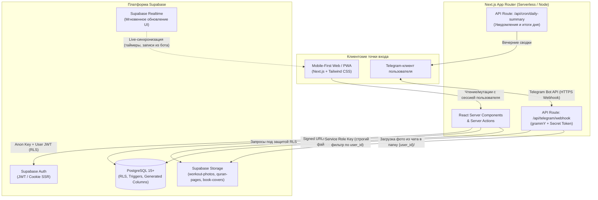

# Архитектура проекта «Умный ежедневник саморазвития»

## 1. Общая концепция и системная архитектура

Приложение строится как **единый модульный Full-Stack монолит** на базе **Next.js (App Router)** и **Supabase**, спроектированный по принципу **Mobile-First / PWA** и синхронизированный в реальном времени с **Telegram-ботом**.



### Ключевые архитектурные решения

1. **Mobile-First & PWA без утяжеления бандла**:
   - Нативный веб-манифест через `src/app/manifest.ts` (`display: 'standalone'`, адаптивные иконки, поддержка iOS Safe Area `env(safe-area-inset-bottom)`).
   - Навигация разделена адаптивно: на смартфонах — нижний `BottomNav` с центральной кнопкой быстрого действия (`QuickAddSheet`), на планшетах и ПК — боковой `Sidebar`.
   - Сжатие фотографий на клиенте перед отправкой в Storage (`webp`, ограничение разрешения до `1920px`), чтобы экономить мобильный трафик и место в хранилище.

2. **Вычисления на стороне PostgreSQL (Zero-Drift Calculations)**:
   - Вместо пересчета показателей только на фронтенде используются **хранимые вычисляемые колонки (`GENERATED ALWAYS AS ... STORED`)** и **триггеры PostgreSQL**:
     - Тоннаж упражнения (`sets_count * reps_count * working_weight`) и суммарный тоннаж тренировки (`workouts.total_tonnage`).
     - Процент прочтения книги (`progress_percent`) и автоперевод статуса в `completed`.
     - Подсчет КБЖУ порции от граммовки (`nutrition_meal_items`) и автоматическая сумма в прием пищи (`nutrition_meals`), плюс готовое SQL-представление `daily_nutrition_summary` для дневных шкал нормы.
     - Автоподсчет минут спринта вайбкодинга (`coding_sprints`) при остановке таймера и накопление часов в темах обучения и коммерческих заказах.
   - Благодаря этому данные всегда консистентны независимо от того, откуда пришла запись — из веб-интерфейса или из Telegram-бота.

3. **Безопасность и изоляция данных (RLS + Приватные бакеты)**:
   - Во всех дочерних таблицах присутствует денормализованный `user_id`, что позволяет RLS-политикам вида `user_id = (SELECT auth.uid())` выполняться за `O(1)` по B-Tree индексу без лишних `JOIN` и с кэшированием `InitPlan` в PostgreSQL.
   - Чувствительные медиафайлы (фото физической формы в `workout-photos` и страницы с заметками тадаббура в `quran-pages`) хранятся в **приватных бакетах** в изолированных папках `{user_id}/{yyyy-mm}/{uuid}.webp` и отдаются клиенту только через временные подписанные ссылки (`Signed URLs`).

4. **Двусторонняя синхронизация с Telegram-ботом**:
   - **Привязка аккаунта (Deep Linking)**: в настройках PWA генерируется одноразовый токен со сроком жизни 15 минут в таблице `telegram_link_tokens` и формируется ссылка `https://t.me/<BotName>?start=<token>`. При нажатии «Запустить» бот через вебхук валидирует токен и сохраняет `telegram_chat_id` в `profiles`.
   - **Единый источник правды**: бот работает через Route Handler `/api/telegram/webhook` (проверяя заголовок `X-Telegram-Bot-Api-Secret-Token`), пишет напрямую в те же таблицы Supabase с пометкой `source = 'telegram'`, а открытое PWA мгновенно подхватывает изменения через `revalidatePath` / Supabase Realtime.

---

## 2. Модульная структура папок (Next.js App Router)

Проект организован по гибридному модульному принципу (**Feature-Based Architecture** внутри `src/`): маршрутизация остается тонкой в `src/app`, а вся бизнес-логика, компоненты, схемы валидации (`zod`) и Server Actions сгруппированы по доменным модулям в `src/features`.

```text
ejednevnik/
├── docs/
│   └── ARCHITECTURE.md                 # Архитектурная документация проекта
├── public/
│   ├── icons/                          # PWA-иконки (192x192, 512x512, maskable, apple-touch-icon)
│   └── sw.js                           # Service Worker для установки PWA и офлайн-оболочки
├── supabase/
│   ├── config.toml                     # Конфигурация локального стека Supabase CLI
│   ├── migrations/
│   │   └── 0001_initial_schema.sql     # Полная схема БД, триггеры, индексы, RLS и Storage
│   └── seed.sql                        # Базовый справочник популярных продуктов (КБЖУ)
├── src/
│   ├── app/                            # Маршрутизация Next.js (App Router)
│   │   ├── (auth)/                     # Группа публичных страниц авторизации
│   │   │   ├── login/page.tsx
│   │   │   ├── register/page.tsx
│   │   │   └── callback/route.ts       # Обмен OAuth/MagicLink кода на сессию
│   │   ├── (dashboard)/                # Защищенная зона ежедневника (общий Mobile-First Layout)
│   │   │   ├── layout.tsx              # Оболочка с BottomNav (моб.) и Sidebar (десктоп)
│   │   │   ├── page.tsx                # Сводный дашборд «Мой день» (все 5 сфер на одном экране)
│   │   │   ├── workouts/               # Раздел «Тренировки» и галерея прогресса формы
│   │   │   ├── books/                  # Раздел «Чтение книг» и база цитат
│   │   │   ├── quran/                  # Раздел «Чтение Корана» и дневник тадаббура
│   │   │   ├── nutrition/              # Раздел «Питание (КБЖУ)» со шкалами дневной нормы
│   │   │   ├── vibecoding/             # Раздел «Вайбкодинг / Обучение / Заказы»
│   │   │   └── settings/               # Профиль, нормы КБЖУ и привязка Telegram-бота
│   │   ├── api/
│   │   │   ├── telegram/
│   │   │   │   └── webhook/route.ts    # Входящий вебхук Telegram-бота
│   │   │   └── cron/
│   │   │       └── daily-summary/route.ts # Ежедневные напоминания и сводки в Telegram
│   │   ├── manifest.ts                 # Генерация Web App Manifest для PWA
│   │   ├── layout.tsx                  # Корневой layout, шрифты, провайдеры темы и тостов
│   │   └── globals.css                 # Tailwind CSS и утилиты мобильных safe-area
│   │
│   ├── features/                       # Изолированные доменные модули бизнес-логики
│   │   ├── workouts/                   # Компоненты, формы, Server Actions и запросы тренировок
│   │   ├── books/                      # Модуль книг, прогресса чтения и цитат
│   │   ├── quran/                      # Модуль чтения Корана, сур/джузов и загрузки страниц
│   │   ├── nutrition/                  # Калькулятор КБЖУ, поиск продуктов, шкалы дневной нормы
│   │   ├── vibecoding/                 # Таймер спринтов, темы обучения и канбан заказов
│   │   └── telegram-sync/              # Обработчики команд бота, парсер быстрого ввода, Deep Link
│   │
│   ├── components/
│   │   ├── layout/                     # BottomNav, Sidebar, MobileHeader, QuickAddSheet
│   │   └── ui/                         # Переиспользуемые атомарные UI-компоненты (shadcn/ui)
│   │
│   ├── lib/
│   │   ├── supabase/
│   │   │   ├── client.ts               # Браузерный клиент (@supabase/ssr)
│   │   │   ├── server.ts               # Серверный клиент для RSC и Server Actions
│   │   │   ├── admin.ts                # Клиент с Service Role (исключительно для Telegram Webhook)
│   │   │   └── storage.ts              # Хелперы загрузки сжатых фото и получения Signed URLs
│   │   ├── telegram/
│   │   │   └── bot.ts                  # Инициализация инстанса бота и клавиатур
│   │   └── utils/                      # Форматирование дат с учетом часового пояса, сжатие фото
│   │
│   ├── types/
│   │   └── database.types.ts           # Автогенерируемые TypeScript-типы схемы Supabase
│   │
│   └── middleware.ts                   # Автообновление сессии Supabase и защита приватных роутов
├── .env.example                        # Шаблон переменных окружения
├── next.config.ts
├── package.json
└── tsconfig.json
```
